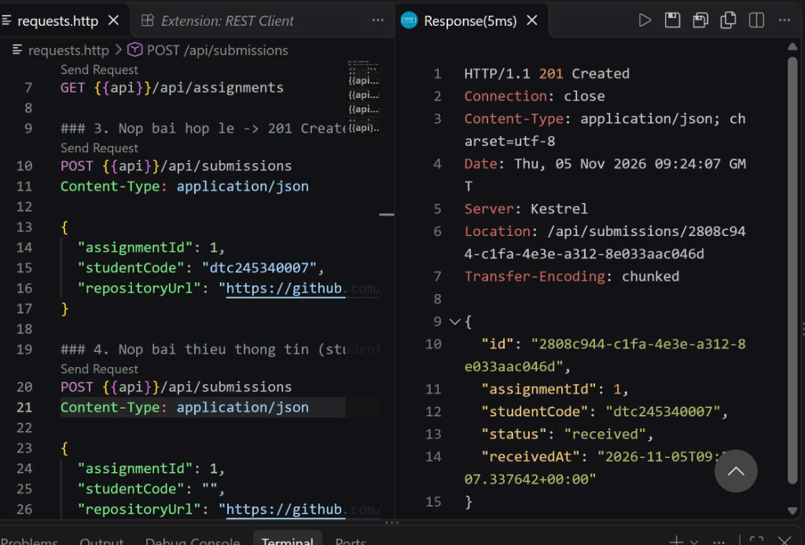
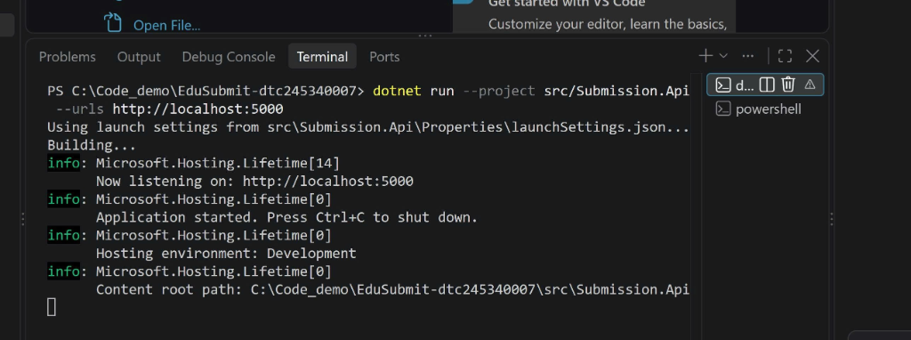
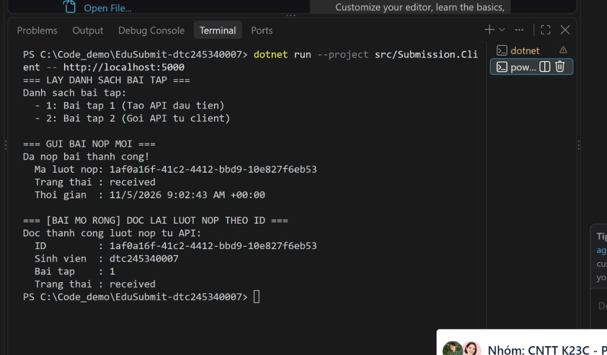
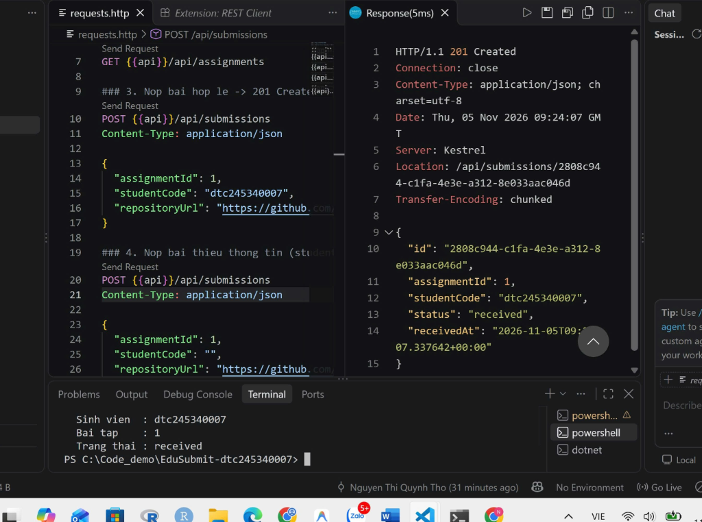

# EduSubmit - Hệ Thống Nộp Bài Phân Tán (Bài 1)

**Sinh viên thực hiện:** Nguyễn Thị Quỳnh Thơ  
**MSSV:** dtc245340007  
**Học phần:** Phát triển ứng dụng phân tán  

---

## 📌 Giới thiệu dự án
Hệ thống **EduSubmit** gồm 2 tiến trình độc lập giao tiếp qua giao thức HTTP:
- **`Submission.Api`**: Máy chủ RESTful Web API xây dựng trên nền tảng ASP.NET Core Minimal API (.NET 10).
- **`Submission.Client`**: Ứng dụng Console gọi API để lấy bài tập, nộp bài tập và tra cứu thông tin lượt nộp (Bài mở rộng).

---

## 📸 Kết quả thực hành thực tế

### 1. Kết quả kiểm thử REST Client (`requests.http`)


### 2. Máy chủ Submission.Api đang chạy


### 3. Máy khách Submission.Client chạy thành công


### 4. Toàn bộ hệ thống chạy đồng thời


---

## 🚀 Hướng dẫn chạy thử dự án

### 1. Khởi động API (Server)
```bash
dotnet run --project src/Submission.Api --urls http://localhost:5000
```

### 2. Khởi động Client
Mở terminal mới và chạy:
```bash
dotnet run --project src/Submission.Client -- http://localhost:5000
```

---

## 📄 Báo cáo chi tiết & Nhật ký thực hành
Toàn bộ câu trả lời, phân tích 5 mô hình trao đổi thông điệp (MEP) và 4 thí nghiệm lỗi xem chi tiết tại:  
👉 **[Nhật ký thực hành Bài 1 (docs/bai1.md)](docs/bai1.md)**
