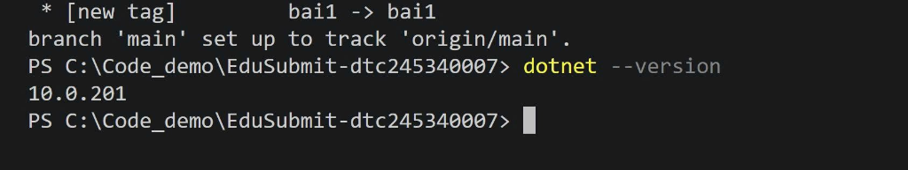
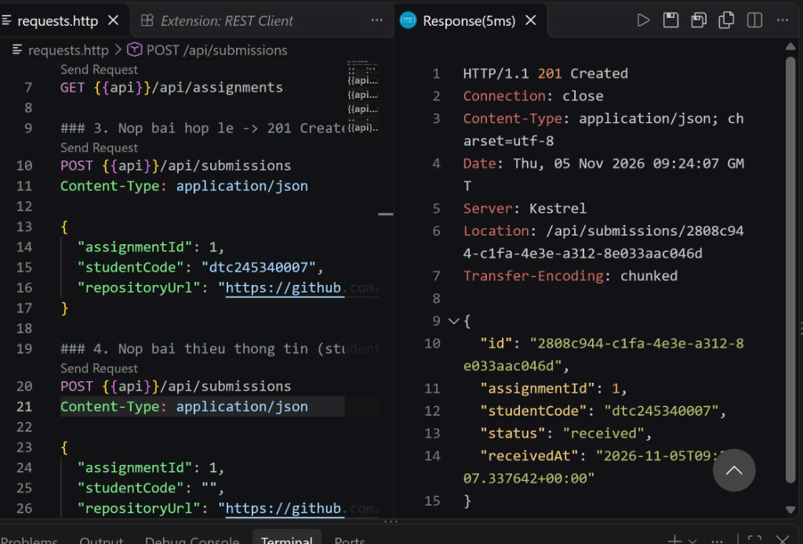
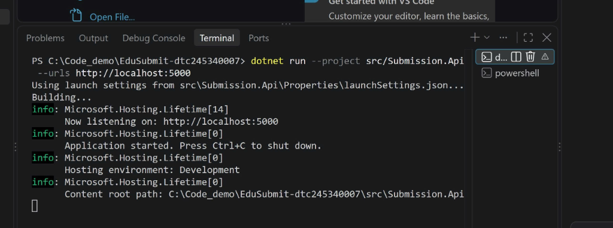
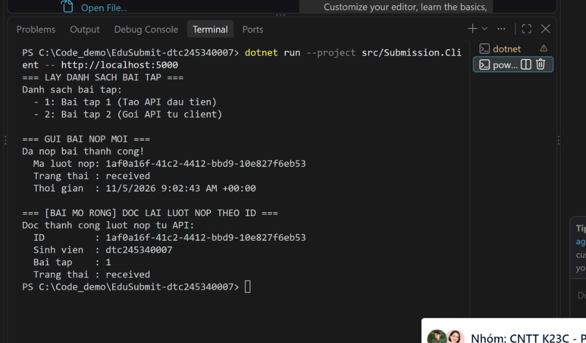
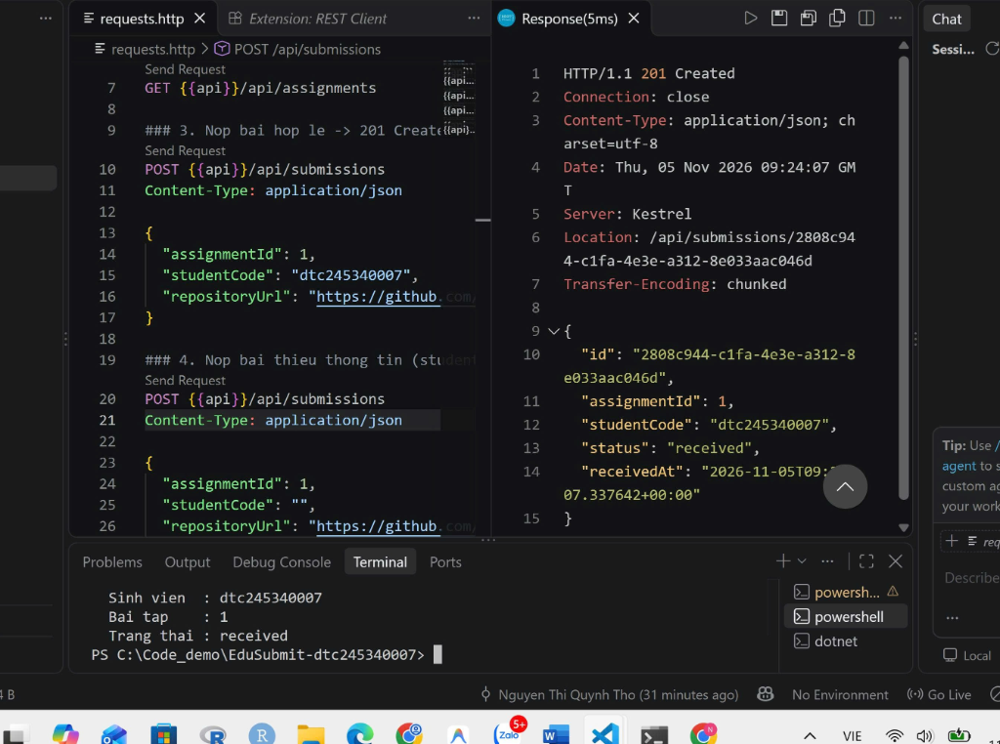

# Bài 1 – Tổng quan hệ thống và MEP
Họ tên: Nguyễn Thị Quỳnh Thơ              MSSV: dtc245340007              Lớp: ĐH CNTT

## 1. Cài đặt
Kết quả kiểm tra môi trường chạy lệnh `dotnet --version`:
- `.NET SDK`: 10.0.201
- `Git`: 2.56.0.windows.2

## 2. MepDemo (Bước 7)
### Trả lời 3 câu hỏi:
1. **Ở MEP 3 (Hàng đợi công việc - Queue-based), mỗi bài nộp sub-x được mấy worker xử lý?**
   - Mỗi bài nộp chỉ được duy nhất **một** worker nhận và xử lý (các worker chia nhau công việc cạnh tranh, đảm bảo không bị xử lý trùng lặp).
2. **Ở MEP 4 (Xuất bản - Đăng ký / Publish-Subscribe), một sự kiện được gửi tới mấy dịch vụ?**
   - Một sự kiện phát ra được gửi tới **tất cả (cả 3)** dịch vụ đã đăng ký nhận sự kiện đó (NotificationService, AnalyticsService, AuditService).
3. **Mô tả 1 câu cho mỗi MEP trong 5 mô hình trao đổi thông điệp:**
   - **MEP 1 (Request-Response):** Bên gửi phát một yêu cầu và chờ đợi phản hồi trả về từ bên nhận trước khi tiếp tục.
   - **MEP 2 (One-Way / Fire-and-Forget):** Bên gửi chỉ phát thông điệp đi và tiếp tục ngay công việc mà không cần chờ đợi phản hồi hay kết quả xử lý.
   - **MEP 3 (Work Queue / Competing Consumers):** Thông điệp được đưa vào một hàng đợi chung và mỗi thông điệp chỉ do một worker rảnh rỗi tiếp nhận xử lý.
   - **MEP 4 (Publish-Subscribe):** Bên gửi phát thông điệp vào một chủ đề (topic), tất cả các dịch vụ đăng ký theo dõi chủ đề đó đều sẽ nhận được bản sao thông điệp.
   - **MEP 5 (Streaming):** Dữ liệu được truyền liên tục thành một dòng các phần tử nhỏ theo thời gian thực giữa hai đầu giao tiếp mà không cần đóng mở kết nối liên tục.

## 3. BasicWebApi (Bước 8)
Kiểm thử gửi request qua `requests.http` bằng REST Client, server trả về mã `201 Created`:

### Trả lời 3 câu hỏi mục 8.4:
1. **Hai dòng `builder.Services.AddSingleton...` và `var app = builder.Build();` – dòng nào phải đứng trước? Vì sao?**
   - Dòng `builder.Services.AddSingleton...` bắt buộc phải đứng trước `builder.Build()`.
   - **Vì:** `builder.Services` dùng để cấu hình và đăng ký các dịch vụ vào IoC/DI container. Sau khi gọi `builder.Build()`, vùng chứa dịch vụ đã được "đóng băng" (hoàn tất xây dựng), ứng dụng không thể thêm hoặc sửa đổi dịch vụ nào vào container được nữa.
2. **Trong `/hello/{name}?language=en`, tham số `name` lấy từ đâu, `language` lấy từ đâu?**
   - Tham số `name` được lấy từ **Route parameter** (đường dẫn URL theo mẫu định tuyến `{name}`).
   - Tham số `language` được lấy từ **Query string parameter** (sau dấu hỏi chấm `?language=en`).
3. **Vì sao POST hợp lệ trả `Results.Created` (201) chứ không phải `Results.Ok` (200)?**
   - Vì theo chuẩn HTTP RESTful, mã trạng thái `201 Created` biểu thị rằng một tài nguyên mới vừa được tạo thành công trên máy chủ và thông thường đi kèm theo header `Location` chỉ dẫn địa chỉ URL để truy cập tài nguyên vừa tạo, trong khi `200 OK` chỉ là phản hồi thành công chung mà không khẳng định việc tạo mới tài nguyên.

## 4. MiniDistributedSystem (Bước 9)
Chạy song song 2 tiến trình: `Submission.Api` (Máy chủ) và `Submission.Client` (Máy khách):

- **Tiến trình máy chủ (Submission.Api):**

- **Tiến trình máy khách (Submission.Client):**

### Trả lời 3 câu hỏi mục 9:
1. **Client gọi những endpoint nào của API? Mỗi lần gọi là một cặp request–response gồm method, URL, mã trạng thái gì?**
   - Lần 1: Method `GET`, URL `/api/assignments`, nhận mã trạng thái `200 OK`.
   - Lần 2: Method `POST`, URL `/api/submissions`, nhận mã trạng thái `201 Created`.
2. **Client có tham chiếu (dùng chung) code của API không? Hai bên "thống nhất" với nhau bằng gì?**
   - Client **không hề** tham chiếu hoặc dùng chung code/project/assembly của API.
   - Hai bên thống nhất với nhau hoàn toàn bằng **Hợp đồng dữ liệu (Data Contract)** thông qua giao thức truyền tải chuẩn HTTP và định dạng dữ liệu chuẩn JSON.
3. **Vì sao địa chỉ API được truyền qua tham số `-- http://localhost:5000` mà không viết cứng trong code?**
   - Để đảm bảo tính linh hoạt, cấu hình động theo từng môi trường triển khai (Development, Staging, Production) mà không phải biên dịch lại mã nguồn khi địa chỉ máy chủ thay đổi.

## 5. Thí nghiệm lỗi (Bước 10)
| # | Thao tác | Dự đoán (ghi TRƯỚC khi chạy) | Kết quả thực tế | Đúng/Sai | Giải thích |
|---|---|---|---|---|---|
| **a** | Thêm bài tập thứ 3 vào mảng `assignments` trên API, chạy lại API rồi chạy Client. | Client vẫn chạy bình thường và tự động in thêm bài tập thứ 3 mà không cần sửa hay build lại code. | Client in ra đầy đủ 3 bài tập: `Bai tap 1`, `Bai tap 2`, `Bai tap 3`. | Đúng | Do Client đọc dữ liệu động dưới dạng mảng JSON qua HTTP, không gắn cứng số lượng bản ghi trong code. |
| **b** | Tắt API (Ctrl+C), sau đó chạy Client. | Client sẽ báo lỗi không thể kết nối tới server vì cổng mạng bị đóng. | Quăng ngoại lệ `HttpRequestException: No connection could be made because the target machine actively refused it`. | Đúng | Gọi qua mạng phụ thuộc vào tính sẵn sàng của tiến trình máy chủ và hạ tầng kết nối, nếu máy chủ tắt thì kết nối TCP bị từ chối; trong khi gọi hàm nội bộ cùng tiến trình thì luôn có sẵn trong bộ nhớ. |
| **c** | Đổi `StudentCode` thành chuỗi rỗng `""` trong Client rồi chạy. | API từ chối nhận bài, trả về mã 400 Bad Request; Client bị dừng ở dòng `EnsureSuccessStatusCode`. | `HttpRequestException: Response status code does not indicate success: 400 (Bad Request)`. | Đúng | API có logic kiểm tra tính hợp lệ (`string.IsNullOrWhiteSpace`) và trả 400. Dòng `EnsureSuccessStatusCode()` trên Client kiểm tra nếu HTTP status không thuộc dải 2xx thì ném ngoại lệ. Máy chủ phải tự kiểm tra vì không thể tin tưởng tuyệt đối dữ liệu từ Client gửi lên. |
| **d** | Chạy API ở cổng 5050, Client vẫn gọi cổng 5000; sau đó sửa cho chạy được mà không sửa code. | Client ban đầu sẽ lỗi kết nối giống kịch bản b. Khắc phục bằng cách truyền tham số cổng 5050 khi chạy lệnh Client. | Chạy lệnh `dotnet run --project ... -- http://localhost:5050` thì Client kết nối và nộp bài thành công. | Đúng | Mã nguồn Client nhận địa chỉ từ tham số dòng lệnh `args[0]`, do đó có thể trỏ tới bất kỳ địa chỉ/cổng nào lúc thực thi mà không cần sửa code. |

## 6. Dự án EduSubmit tự làm (Bước 11-12)
- **Tình trạng:** Đã hoàn thành cả phần cốt lõi và bài mở rộng (lưu trữ danh sách submissions và endpoint `GET /api/submissions/{id}`).
- **Mức độ xem code mẫu:** Tự xây dựng cấu trúc theo hướng dẫn; chỉ xem lại cú pháp `Results.Created` và `ReadFromJsonAsync` để đảm bảo chuẩn Minimal API.
- **Luồng thông điệp trong hệ thống:**
  - `Client --(HTTP GET /api/assignments)--> Api` : Request-Response (Lấy danh sách các bài tập).
  - `Client --(HTTP POST /api/submissions)--> Api` : Request-Response (Gửi thông tin nộp bài, nhận về Guid và trạng thái `received`).
  - `Client --(HTTP GET /api/submissions/{id:guid})--> Api` : Request-Response (Kiểm tra và đọc lại thông tin chi tiết bài nộp vừa tạo).

### Kết quả chạy hoàn chỉnh hệ thống EduSubmit (API + Client + REST Client):

## 7. Khó khăn gặp phải và cách giải quyết
1. **Lỗi cổng bị chiếm dụng (Address already in use):** Khi chạy thử nghiệm nhiều lần, tiến trình API cũ có thể vẫn chiếm giữ cổng 5000.  
   *Cách giải quyết:* Dừng tiến trình cũ bằng `Ctrl + C` hoặc kiểm tra task nền trước khi khởi chạy lại.
2. **Quyền truy cập thư mục:** Gặp lỗi Permission Denied khi tạo thư mục tại ổ `D:\`.  
   *Cách giải quyết:* Chuyển sang tạo và làm việc trên đường dẫn hợp lệ `C:\Code_demo\EduSubmit-dtc245340007` theo đúng hướng dẫn dự phòng trong tài liệu thực hành.
3. **Xử lý bất đồng bộ khi Client đọc dữ liệu:** Cần đảm bảo kiểm tra mã trạng thái với `EnsureSuccessStatusCode()` trước khi gọi `ReadFromJsonAsync` để tránh lỗi parse JSON khi server trả về mã lỗi 400 hay 500.
